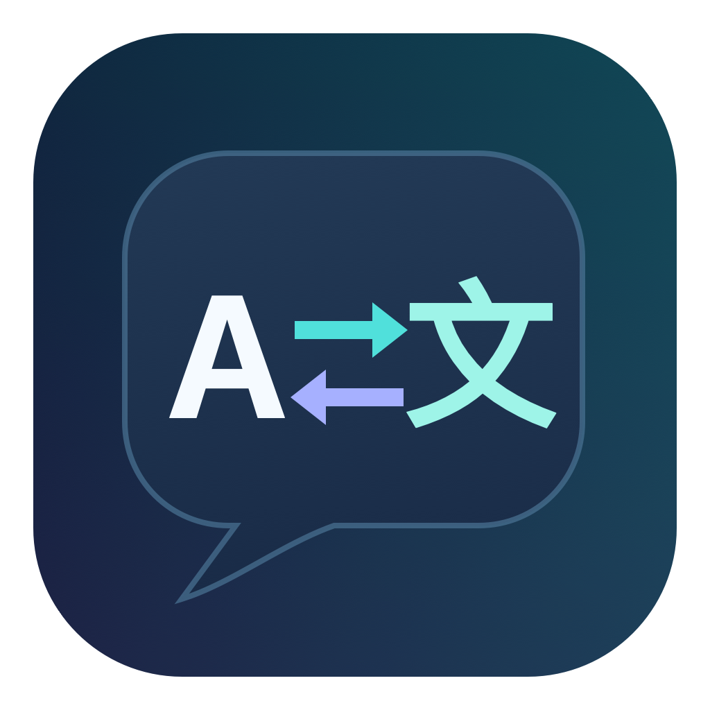

<p align="center"><a href="../">English</a> | 简体中文</p>

# 划词系统翻译



在其他 Mac 应用中用鼠标选中英文或中文，松开鼠标后自动在附近显示译文。翻译使用 macOS 的 Apple Translation 框架。

## 功能与费用

- 支持英语与简体中文双向整句翻译；浮窗随译文调整大小，较长译文可滚动。菜单栏可暂停划词监听或打开设置。
- 使用 Apple 管理的设备端翻译模型；本项目不需要翻译账号、API 密钥、订阅或按次付费服务。首次使用可能需要经系统许可下载语言包。
- 应用只显示译文，不自动替换原文，也不自动写入剪贴板。它不是 macOS 词典的词条释义界面。

## 环境与构建

- Apple Silicon Mac，macOS **26.4 或更新版本**。目前构建目标只有 `arm64`，不支持 Intel Mac 或更早的 macOS。
- 安装提供相应 macOS SDK 的 Xcode／开发工具。项目用 Swift 6、SwiftUI、AppKit 和系统框架编写；构建脚本直接调用 `swiftc`，无需 SwiftPM 或第三方依赖。

在仓库目录运行：

```sh
./build.sh
open dist/AppleSelectionTranslate.app
```

如果当前选中的开发工具找不到兼容 SDK，可设置 `MACOS_SDK_PATH` 为本机已安装的 SDK 路径再构建。应用图标已包含在仓库中；修改 [图标绘制源码](../tools/render_icon.swift) 后运行 `./tools/generate_icon.sh`，再运行 `./build.sh`。

## 首次设置与使用

1. 把 `.app` 放在打算长期使用的位置，再启动它。在设置窗口点“请求授权”，到“系统设置 → 隐私与安全性”中允许该应用访问辅助功能。不同 macOS 版本的栏目名称可能不同；本机 macOS 27 显示为“设备控制和数据访问”。返回应用后点“重新检查并开始”。每台 Mac 都要单独授权。
2. 在同一窗口点“准备英中双向翻译”，允许 macOS 下载英语与简体中文语言包，等页面显示已就绪。
3. 在其他应用中拖选文字、双击或三击选词，或者按住 Shift 点击扩展选区。完成选区后无需再点翻译按钮，浮窗会自动出现。菜单栏的“设置与语言包…”可重新打开设置。

## 已知问题与功能边界

- **权限可能在重新构建后失效。** `build.sh` 使用临时签名，代码变化会改变 macOS 识别的应用身份。系统开关即使看似已开启，应用仍可能显示“尚未授权”。退出应用，从权限列表移除旧条目，重新添加并开启当前的 `.app`，再启动并重新检查。当前构建未使用 Developer ID 签名，也未经过 Apple 公证；不提供可直接分发的公证安装包。[Apple 对临时签名身份的说明](https://developer.apple.com/documentation/technotes/tn3127-inside-code-signing-requirements)。
- 自动触发只识别鼠标拖选、双击／三击和 Shift 点击；普通单击、纯键盘选区与全局快捷键不会触发。相同控件中未变化的旧选区不会反复弹出；如果该应用不提供选区范围，需要先选中不同文字才能再次翻译同一段。
- 只读取前台应用通过 macOS 辅助功能接口公开的**当前选中文字**。部分浏览器页面、终端、文档阅读器或自绘控件可能不提供该信息，因此不会弹窗；没有截屏、OCR 或复制剪贴板的兜底方式。跨应用兼容性尚未全面实测。
- 目前设置页只准备**英语 ↔ 简体中文**。繁体中文被识别时会尝试翻译，但系统可能不支持该语言对；其他语言不支持。短词、繁简共用汉字和中英混合文本可能被误判，请尝试选中更长且单一语言的内容。
- 过长选区会被忽略：上限为 5,000 个 Swift 字符、10,000 个 UTF-16 单元和 20,000 个 UTF-8 字节。翻译质量、语言对和模型可用性由 macOS 决定。当前应用界面只有简体中文。

## 隐私与权限

辅助功能是一项范围较广的系统权限。程序仅在上述鼠标选区手势后读取前台焦点控件的选中文字，拒绝安全文本框；它不读取整个输入框、不保存翻译历史、不读取或修改剪贴板，源码中也没有应用自建的网络请求。你主动选中的敏感文字仍会进入应用内存和系统翻译流程；可随时从菜单栏暂停，或到系统设置撤销权限。[Apple 说明](https://developer.apple.com/documentation/translation/translationsession) `TranslationSession` 在设备上处理原文和译文，但 Apple 可能收集不含文字内容的 API 使用和性能指标。

源码审查的验证范围与剩余风险见 [安全审查说明](../SECURITY_REVIEW.md)。

## 许可证

本项目采用 [MIT 许可证](../LICENSE)。
